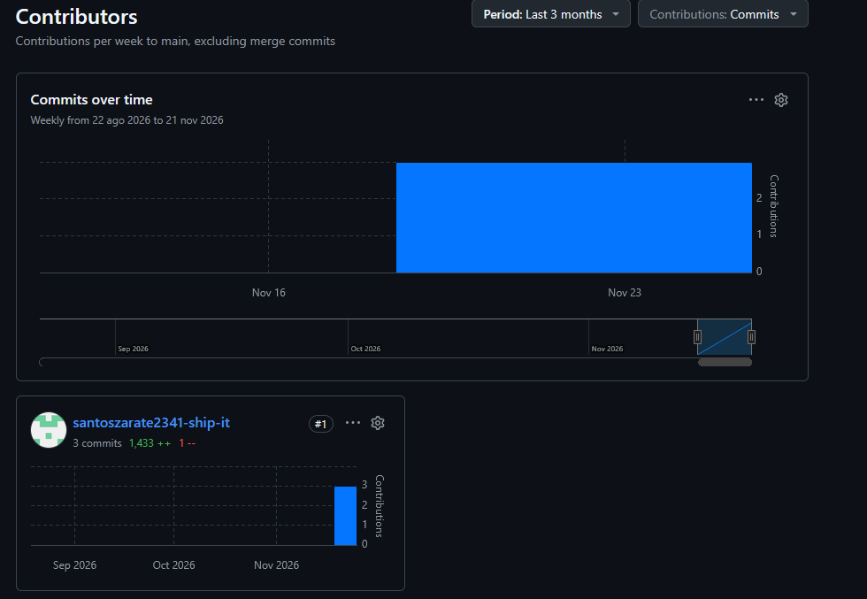

# Métodos Estadísticos

## Información general

**Curso:** Métodos Estadísticos  
**Estudiante:** Santos Zárate  
**Repositorio:** Metodos-Estadisticos

## Objetivo del repositorio

Este repositorio tiene como objetivo organizar y conservar las actividades desarrolladas durante el curso de Métodos Estadísticos, utilizando principalmente R y RStudio para el manejo, procesamiento y análisis de datos.

También funciona como un respaldo de los trabajos realizados, permitiendo consultar los procedimientos, revisar los resultados y llevar un seguimiento de los avances mediante Git y GitHub.

## Utilidad del repositorio

- Organizar cronológicamente los laboratorios y actividades.
- Almacenar bases de datos y archivos utilizados en las prácticas.
- Desarrollar y conservar scripts de R.
- Aplicar procedimientos estadísticos a diferentes conjuntos de datos.
- Consultar y mejorar los trabajos realizados durante el curso.
- Llevar un historial de modificaciones mediante GitHub.

## Actividades realizadas durante el curso

### 1. Laboratorio 1

**Descripción:** Desarrollo de la primera actividad práctica del curso, utilizando los recursos y materiales correspondientes para trabajar con los procedimientos estadísticos.

**Archivo:** `Laboratorios/Laboratorio1.docx`.

### 2. Laboratorio 3

### 3. Laboratorio 4

### 4. Laboratorio 5

### 5. Asignación 6. Análisis de regresión lineal

**Descripción:** Desarrollo de un análisis de regresión lineal simple para estudiar la relación entre el diámetro a la altura del pecho (DAP) y la edad de ejemplares de *Pinus arizonica*.

Durante esta actividad se trabajó con la exploración de datos, elaboración de gráficas, planteamiento de hipótesis, ajuste del modelo de regresión, interpretación de resultados y generación de predicciones.

**Archivo:** `A6_Zarate_Santos.R`.

### 6. Laboratorio 6

### 7. Laboratorio 7

### 8. Laboratorio 8

### 9. Laboratorio 9

## Herramientas utilizadas

- **R:** Lenguaje utilizado para el análisis estadístico y procesamiento de datos.
- **RStudio:** Entorno de trabajo para desarrollar y ejecutar los scripts.
- **Git:** Herramienta para controlar las versiones de los archivos.
- **GitHub:** Plataforma para almacenar y compartir el proyecto.

## Evidencia de contribuciones

La siguiente imagen muestra la gráfica de contribuciones del repositorio, obtenida desde la sección Insights → Contributors de GitHub.

## Organización de los archivos

- `Bases De Datos/`: conjuntos de datos utilizados.
- `Laboratorios/`: documentos y actividades prácticas.
- `LABS PDF/`: materiales y documentos PDF de los laboratorios.
- `Metodos Estadisticos.Rproj`: archivo principal del proyecto de RStudio.

## Conclusión

Este repositorio reúne las actividades y evidencias desarrolladas durante el curso de Métodos Estadísticos. Su organización permite mantener un registro de las prácticas, conservar los datos y scripts utilizados y consultar los análisis realizados. Además, GitHub facilita el respaldo y seguimiento de los avances del proyecto.